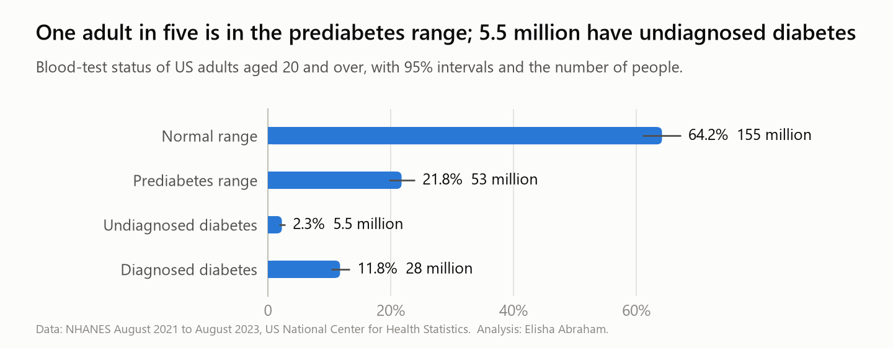
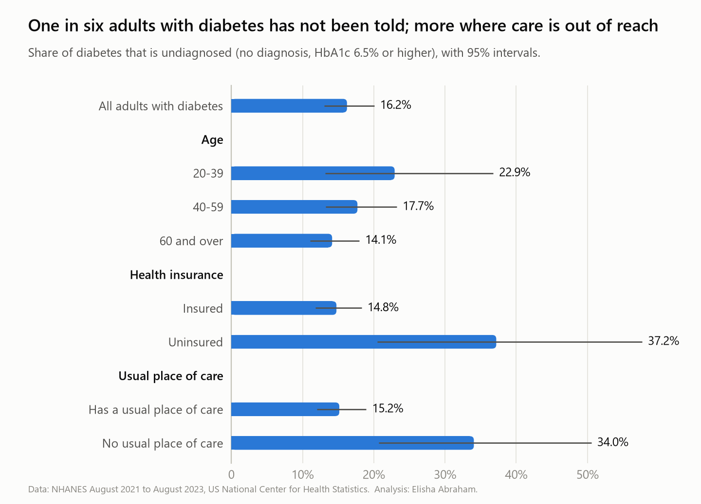
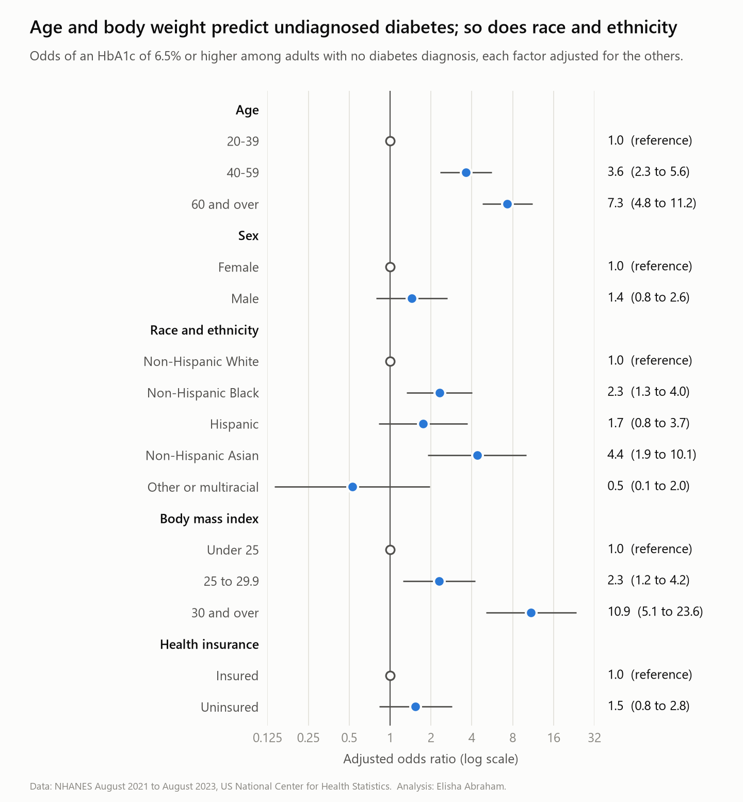

# Undiagnosed diabetes in US adults

**How many adults have diabetes without knowing it, who are they, and which screening rule finds them?**

A Python analysis of the US National Health and Nutrition Examination Survey (NHANES), August 2021 to August 2023. NHANES examines a sample of the population and takes blood, so it can find diabetes in people who have never been told they have it. The analysis handles the survey's weights, strata and sampling units from first principles and checks the result against an independent library.

`Python` · `pandas` · `NumPy` · `survey statistics` · `logistic regression` · `Jupyter` · `matplotlib`

Read the full analysis with its output in [`analysis.ipynb`](analysis.ipynb).

## The short answer

1. **About 5.5 million US adults have diabetes that has not been diagnosed.** That is 2.3% of adults (95% interval 1.8 to 2.9), and one in six of all adults with diabetes (16.2%, 13.0 to 20.1).
2. **A further 53 million are in the prediabetes range**, 21.8% of adults. Only 27% of them have been told.
3. **Most of the undiagnosed are already inside the health system.** 86% have health insurance, 88% have a usual place of care, half have been told they have high blood pressure, and 40% have been told they have prediabetes.
4. **Where care is out of reach, far more diabetes goes unfound.** Among adults with diabetes, 37% of the uninsured are undiagnosed against 15% of the insured. These groups are small and the intervals wide (20 to 58 for the uninsured).
5. **Age and body weight are the strongest predictors.** Among adults with no diagnosis, the odds of an HbA1c of 6.5% or more are 7 times higher at 60 and over than at 20 to 39, and 11 times higher at a BMI of 30 and over than under 25. At the same age and BMI, the odds are also higher for non-Hispanic Asian adults (4.4 times) and non-Hispanic Black adults (2.3 times) than for non-Hispanic White adults.
6. **The standard screening rule misses a third of cases, mostly older people.** Testing adults aged 35 to 70 with a BMI of 25 or over covers 68% of undiagnosed cases. Nearly a quarter of all cases (23%) are in people over 70.

## What I would recommend

Written for a health system or insurer deciding how to find undiagnosed diabetes.

| # | Action | Evidence |
|---|---|---|
| 1 | Look inside existing care before building outreach. Add an HbA1c test to visits that already happen, starting with blood pressure follow-up. | 88% of undiagnosed adults have a usual place of care; half have been told they have high blood pressure. |
| 2 | Do not let an age limit of 70 end the search. | 23% of undiagnosed cases are over 70. Whether to test an older adult is a clinical judgement, but that is where a rule capped at 70 loses its cases. |
| 3 | Follow up people already told they have prediabetes. | 40% of adults with undiagnosed diabetes have been told they have prediabetes. They were identified once and not retested. |
| 4 | Tell people in the prediabetes range. | 53 million adults; 27% have been told. |
| 5 | Treat coverage as part of detection. | The undiagnosed share of diabetes is 37% without insurance and 34% without a usual place of care, against 15% with either. |

## Findings in detail

### How common

<picture>
  <source media="(prefers-color-scheme: dark)" srcset="figures/glycaemic_status_dark.png">
  
</picture>

### Who has not been told

<picture>
  <source media="(prefers-color-scheme: dark)" srcset="figures/undiagnosed_share_by_group_dark.png">
  
</picture>

The undiagnosed share looks higher among younger adults with diabetes (23% at 20 to 39) than older ones (14% at 60 and over), which would fit a condition that is looked for less in the young. With only 52 younger adults with diabetes in the sample, that interval is wide and the difference is not established.

### What predicts it

<picture>
  <source media="(prefers-color-scheme: dark)" srcset="figures/odds_ratios_dark.png">
  
</picture>

Each factor is adjusted for the others. Sex and insurance show no clear difference once age, race and ethnicity, and BMI are accounted for: their intervals include 1.

### Which screening rule finds the cases

Each rule is applied to adults with no diabetes diagnosis.

| Rule | Adults tested | Undiagnosed cases covered | Tests to find one case |
|---|---|---|---|
| Age 35 to 70 with BMI of 25 or over (US Preventive Services Task Force, 2021) | 44% | 68% (59 to 76) | 25 |
| The same, with BMI of 23 or over for Asian adults | 44% | 69% (59 to 77) | 25 |
| Everyone aged 45 or over | 52% | 77% (69 to 84) | 26 |
| Everyone aged 35 or over | 71% | 95% (92 to 97) | 29 |

Testing everyone from 35 finds almost every case and costs four more tests per case found. Of the cases the first rule misses, most are people older than 70 (23% of all cases); 5% are under 35 and 3% are aged 35 to 70 with a BMI under 25.

## How it was done

| Step | File | What it does |
|---|---|---|
| 1 | [`scripts/01_download_nhanes.py`](scripts/01_download_nhanes.py) | Downloads eight NHANES files and records their sizes and checksums. |
| 2 | [`scripts/02_build_analysis_table.py`](scripts/02_build_analysis_table.py) | Merges them, decodes the survey's answer codes, derives the outcome, and checks the result. |
| 3 | [`src/survey.py`](src/survey.py) | Survey estimation: proportions, population totals and logistic regression with design-based standard errors. |
| 4 | [`analysis.py`](analysis.py) | The analysis, as plain Python with cell markers. |
| 5 | [`scripts/build_notebook.py`](scripts/build_notebook.py) | Turns `analysis.py` into [`analysis.ipynb`](analysis.ipynb) and runs every cell. |

### Why the survey design matters

NHANES is not a simple random sample. People are sampled within areas, areas within strata, and each person carries a weight. Treating the data as a simple sample gives a believable estimate with a standard error that is too small.

[`src/survey.py`](src/survey.py) implements Taylor linearisation, the method behind SAS SURVEYMEANS, Stata's `svy` and SPSS Complex Samples, in about a hundred lines of NumPy:

- **Subgroups are domains, not subsets.** People outside a subgroup stay in the calculation with a contribution of zero, so every sampling unit is still counted. Deleting them would understate the variance.
- **Fifteen degrees of freedom.** This cycle has 30 sampling units in 15 strata. Intervals use the t distribution with 15 degrees of freedom (multiplier 2.13, not 1.96), and the regression is kept to ten coefficients.
- **The blood-test weight.** HbA1c comes from a blood sample that not everyone gave, so the analysis uses the survey's phlebotomy weight, not the interview weight.

### How I know the numbers are right

- **An independent check on the regression.** The coefficients are fitted with my own Newton's method. statsmodels, fitting the same weighted model, agrees to eleven decimal places. The notebook asserts this on every run.
- **Checks in the build script.** One participant per row, 15 strata with two sampling units each, and every HbA1c value in a plausible range. The last check caught a real bug during development: a cleaning step was turning missing values into zeros. The script stopped instead of producing a wrong answer.
- **Totals that make sense.** The weighted sample represents 242 million adults, in line with the US adult population.

## Limits of this analysis

- **HbA1c alone.** Surveys that also use fasting glucose find more undiagnosed diabetes. These figures are a floor.
- **One blood test is not a diagnosis.** Clinical diagnosis needs a repeat test.
- **"Diagnosed" is self-reported.**
- **Wide intervals.** With 15 degrees of freedom, small groups cannot be reported reliably, and the standard errors are themselves estimates. An interval can come out too narrow or too wide by chance.
- **Associations, not causes.** The regression describes who is more likely to be undiagnosed. It does not show why.
- **United States, 2021 to 2023.**

## Run it yourself

Requirements: Python 3.10 or later.

```bash
pip install -r requirements.txt
python scripts/01_download_nhanes.py
python scripts/02_build_analysis_table.py
python scripts/build_notebook.py
```

## Repository layout

```
data/raw/        NHANES files as downloaded, with a manifest
data/analysis/   one row per participant, ready for analysis
scripts/         download, build and notebook scripts
src/             survey estimation and chart helpers
analysis.py      the analysis source
analysis.ipynb   the same analysis, executed, with output
results/         every table as CSV
figures/         charts, in light and dark variants
```

## Data source

Centers for Disease Control and Prevention, National Center for Health Statistics. National Health and Nutrition Examination Survey data, August 2021 to August 2023. Hyattsville, MD: US Department of Health and Human Services. https://wwwn.cdc.gov/nchs/nhanes/

Screening criteria: US Preventive Services Task Force. Screening for prediabetes and type 2 diabetes: recommendation statement. JAMA, 2021.

NHANES data are in the public domain. Code in this repository: MIT licence.

## Author

**Elisha Abraham** is a healthcare and research data analyst with clinical training in nursing.
[LinkedIn](https://www.linkedin.com/in/elisha-abraham-a90569352) · [GitHub](https://github.com/elisha-abraham) · elishaabraham25@gmail.com
